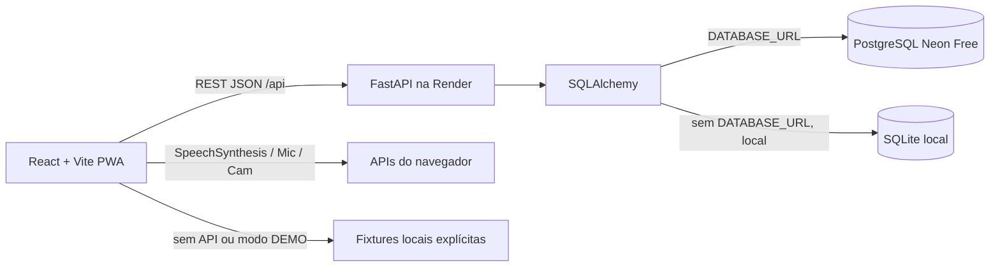

# SUPERPED MVP 4H — ARQUITETURA, DONOS E INTEGRAÇÃO

## Monorepo de destino

```text
superped/
  frontend/
    index.html
    package.json
    public/{manifest.webmanifest,icons/}
    src/
      main.tsx
      app/{App.tsx,router.tsx,AuthProvider.tsx}
      components/{ui/,layouts/,common/}
      styles/{index.css,tokens.css}
      lib/{api.ts,types.ts,demo.ts}
      pages/{public/,doctor/,guardian/,child/,developer/}
      features/{medications/,messages/,assistant/,games/,child-voice/}
  backend/
    requirements.txt
    app/
      main.py
      core/{config.py,security.py,database.py,dependencies.py}
      models/{entities.py,schemas.py}
      routers/{auth.py,patients.py,routines.py,mood.py,medications.py,messages.py,assistant.py,games.py,developer.py}
      seed.py
      tests/
  docs/{CONTRATO_MVP_4H.md,ARQUITETURA_E_OWNERSHIP.md}
  README.md
  .env.example
  .gitignore
```

## Autoridade sobre arquivos
- **Agente 02 Scaffold**: estrutura monorepo, `frontend/src/lib/types.ts` e `api.ts` base, `backend/app/main.py` base, envs, package e requirements, roteador stub. CONGELAR depois.
- **Agente 03 UI**: `frontend/src/styles/**`, `frontend/src/components/ui/**`, `frontend/src/components/layouts/**`, `frontend/src/pages/public/**`.
- **Agente 04 Auth**: `backend/app/core/security.py`, `dependencies.py`, `routers/auth.py`, `frontend/src/app/AuthProvider.tsx`. NÃO mexe em router global; exporta provider.
- **Agente 05 Banco**: `backend/app/models/**`, `core/database.py`, `seed.py`. Backend `models` compartilhados só com esse agente.
- **Agente 06 Médico**: `frontend/src/pages/doctor/**`, `backend/app/routers/patients.py`.
- **Agente 07 Família**: `frontend/src/pages/guardian/**`, `backend/app/routers/routines.py`, `backend/app/routers/mood.py`.
- **Agente 08 Infantil**: `frontend/src/pages/child/**` (sem games), tema mascote exportado.
- **Agente 09 Jogos**: `frontend/src/features/games/**`, `backend/app/routers/games.py`.
- **Agente 10 Medicamentos**: `frontend/src/features/medications/**`, `backend/app/routers/medications.py`.
- **Agente 11 Chat+FAQ**: `frontend/src/features/messages/**`, `frontend/src/features/assistant/**`, `backend/app/routers/messages.py`, `routers/assistant.py`.
- **Agente 12 Mobile+Voz**: `frontend/src/features/child-voice/**`, `frontend/public/**` (somente manifest e ícones), componentes de responsividade próprios em `components/common/`.
- **Agente 13 Dev**: `frontend/src/pages/developer/**`, `backend/app/routers/developer.py`.
- **Agente 14 Integração**: ÚNICO autorizado a mexer após freeze em `frontend/src/app/router.tsx`, `App.tsx`, `lib/api.ts`, `backend/app/main.py` (imports e `include_router`), conflitos e ajustes pontuais.
- **Agentes 15–18**: testes, deploy, docs e contingência. Alterações de código cruzadas só com coordenação.

## Fluxo de dados



## Regras de integração
1. Cada módulo **exporta** o componente principal e o `APIRouter` com `prefix` próprio. Só Agente 14 conecta ao router/menu global.
2. Os endpoints obedecem `CONTRATO_MVP_4H.md`. Se algo não existir, frontend faz fallback demo com badge 'Modo offline demonstrativo', NUNCA finge salvar no servidor.
3. Backend só recebe `DATABASE_URL` via env. SQLite `sqlite:///./superped_demo.db` é **local**, incompatível com persistência após restart Render.
4. Na Vercel configurar `VITE_API_URL=https://<backend>.onrender.com`; no Render `FRONTEND_URL=https://<front>.vercel.app`, `DATABASE_URL`, `JWT_SECRET` e `DEMO_MODE=true`. Segredos nunca versionados.
5. CORS deve permitir somente origens explicitamente configuradas (+localhost dev); sem `*` junto a credenciais.
6. Nunca enviar navegador diretamente ao Neon. DB_URL fica somente no backend.
7. Lembretes demonstrativos no navegador ativo; não prometer entrega com app encerrado.
