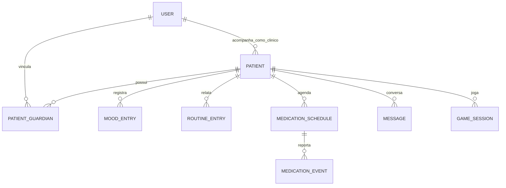

# Modelo resumido para as IAs

As tabelas e campos oficiais estão no `CONTRATO_MVP_4H.md`. `source` e `reporter_user_id` nunca vêm sem validação da sessão. Notificação local nunca vira evidência de administração. `MedicationSchedule` representa prescrição fictícia inserida pelo médico; `MedicationEvent` representa relato.
